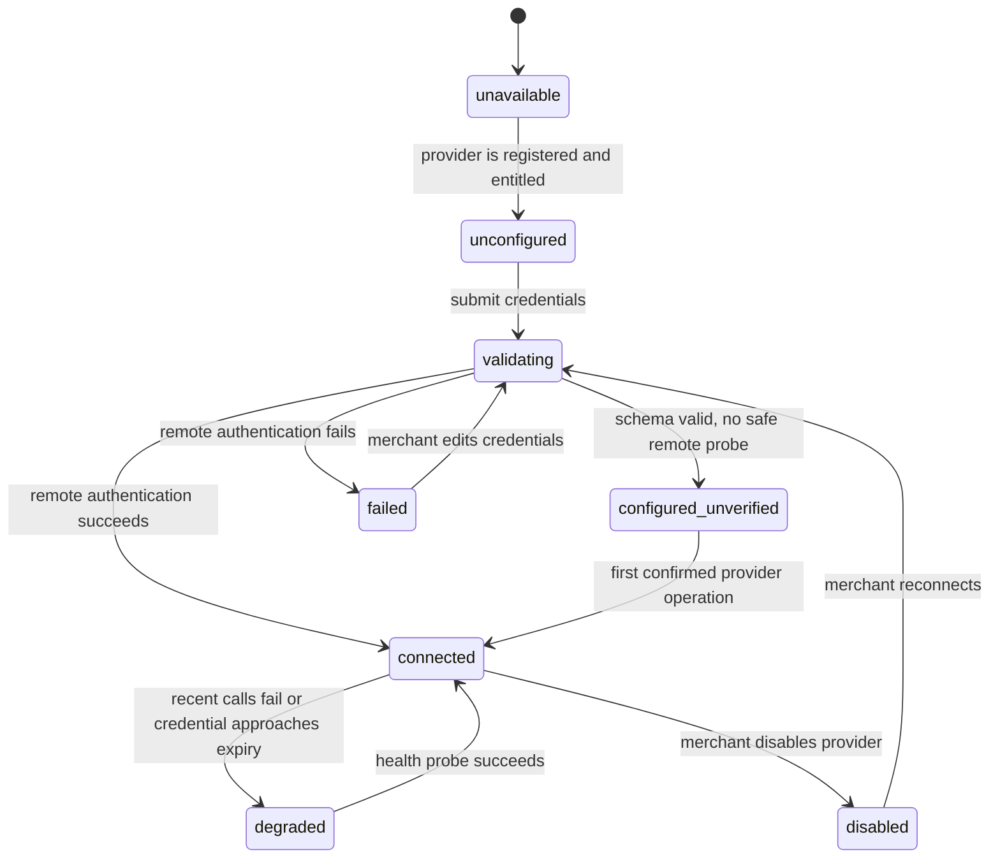

# Vendryx product rebrand, interface adaptation, and provider integration plan

**Status:** Draft for owner review  
**Owner:** Syed Systems  
**Prepared:** 2026-09-08  
**Target product name:** Vendryx  
**Internal engine codename:** `stheno` remains unchanged in the first migration  
**Reference set:** `C:\Users\Mahi\Downloads\1.png` through `18.png`, plus `domain.png`

This is the execution contract for adapting the public site, merchant dashboard, operator
control plane, and integration setup experience to the Vendryx brand. It is intentionally
specific. An implementer should not need to invent page structure, state semantics, security
behavior, or completion criteria.

The screenshots are direction, not source code. Port the visual grammar and interaction model.
Do not copy the Lokzon wordmark, proprietary copy, unsupported claims, fabricated metrics, or
partner logos without permission.

---

## 1. Outcome

Vendryx should feel like a mature commerce operating system for Bangladeshi merchants:

- The public site explains the product with calm confidence and real product imagery.
- Sign-in and onboarding feel like part of the same product, not a separate template.
- The merchant dashboard is dense enough for daily operations without becoming visually noisy.
- Payment and courier setup uses one predictable flow: select provider, enter credentials,
  validate, choose availability, activate, and monitor health.
- A saved secret is never mislabeled as a working connection.
- Every customer-facing occurrence of the former product name becomes Vendryx.
- Internal names stay stable until a separate compatibility migration is approved.

### Success statement

A merchant can open Vendryx, understand the product, create an account, configure a supported
payment gateway, configure a supported courier, complete a sandbox transaction and parcel
booking, and see accurate connection health without an operator editing the database.

---

## 2. Architecture ladder decision

**Stop at rung 2: reuse what already exists.**

The repository already contains:

- merchant-scoped payment credential schemas and encrypted storage;
- AES-256-GCM credential encryption with tenant and provider binding;
- merchant Admin API routes for listing providers, saving credentials, and enabling regions;
- schema-driven credential forms in `apps/admin`;
- platform-level corporate payment credential management in `apps/platform`;
- bKash, SSLCommerz, Stripe, and offline payment provider crates;
- the Medusa-derived accessible component system used by both admin surfaces;
- a complete marketing app with the required public and authentication routes.

Do not build a second credential vault, second payment settings page, second modal library, or
new dashboard framework. Refactor the existing surfaces into the Vendryx design system and add
only the missing provider-verification and courier capabilities.

---

## 3. Current state and gap statement

| Capability | Current evidence | Decision |
|---|---|---|
| Marketing and auth routes | `apps/marketing/src/App.tsx` includes `/`, `/demo`, `/login`, `/signup`, `/forgot-password`, `/welcome`, `/privacy`, `/terms` | Restyle and decompose; preserve paths and metadata intent |
| Merchant admin | `apps/admin` is the curated Medusa dashboard fork | Adapt shell and targeted product routes; do not rebuild all inherited commerce screens |
| Operator control plane | `apps/platform` uses Medusa UI primitives; extracted to standalone **Space** (`D:\Syed Systems\Space`, [ADR-030](DECISIONS.md#adr-030)) | Maintain `apps/platform` as transitional surface; future development in Space |
| Merchant payment setup | `/admin/payment-providers` and `/admin/payment-providers/{id}/credentials` exist | Reuse, add verification and honest connection states |
| Payment providers | bKash, SSLCommerz, Stripe, and offline provider crates are registered | Harden and prove with sandbox fixtures |
| Courier registry | only the manual fulfillment provider is registered in `stheno-server` | Build the courier factory and credential layer before showing partner Connect buttons |
| Courier implementations | Pathao, Steadfast, and RedX are tasks in `PHASE3_TASKS.md`, not provider crates | Implement P23; no fake connected state |
| Branding | Stheno assets and strings remain across public apps and docs | Public rename to Vendryx; internal identifiers remain compatible |
| Documentation | 37 files contain 935 matches for Stheno/Lokzon forms, many of which are code identifiers | Classify each match; never use blind global replacement |

### Known constraint

The worktree already contains unrelated modifications. Each implementation task must inspect
`git diff` before editing, preserve user changes, and limit its diff to the files named by that
task.

---

## 4. Decisions fixed by this plan

### 4.1 Brand architecture

| Layer | Name after migration | Rename now? |
|---|---|---|
| Customer-facing product | Vendryx | Yes |
| Public wordmark, favicon, metadata, emails | Vendryx | Yes |
| Legal product references | Vendryx by Syed Systems | Yes, after legal-copy review |
| Rust crate names | `stheno-*` | No |
| Cargo package and binary names | `stheno-*`, `stheno-server` | No |
| Database schemas and migration history | existing names | No |
| Environment variables | `STHENO_*` | No in phase 1 |
| Compatibility headers | `X-Stheno-CSRF` | No in phase 1 |
| Internal TypeScript package names | `@stheno/*` | No in phase 1 |

Every public document introduces the relationship once:

> Vendryx is the customer-facing product. The repository retains the internal `stheno-*`
> identifiers for compatibility.

Do not expose that sentence in marketing copy.

### 4.2 Design read

This is a greenfield Vendryx identity applied to an existing product and information
architecture.

| Surface | Design variance | Motion | Density |
|---|---:|---:|---:|
| Marketing | 6/10 | 4/10 | 3/10 |
| Authentication | 4/10 | 2/10 | 3/10 |
| Merchant admin | 4/10 | 3/10 | 7/10 |
| Credential dialog | 3/10 | 2/10 | 6/10 |
| Operator platform | 3/10 | 2/10 | 8/10 |

Marketing may use restrained scroll reveals. Admin motion communicates state only. No parallax,
glow effects, scroll hijacking, animated counters, or decorative perpetual motion in product UI.

### 4.3 Information architecture

Existing URLs remain stable. Screenshot labels may become tabs or section headings, but they do
not rename routes.

- Merchant store settings remain under `/settings/store`.
- Payment providers remain `/settings/payment-providers`.
- Users remain `/settings/users`.
- Profile remains `/profile`.
- Analytics remains `/analytics`.
- Domain and courier routes are mounted only when their backend and entitlement are ready.
- The screenshot's merchant “Policies” tab must not reuse `/settings/policies`, which is the RBAC
  policy editor. Use a section on `/settings/store` unless an ADR approves a new route.
- Wallet and withdrawal screens do not ship as static mockups. They require real settlement and
  payout data contracts first.

### 4.4 One integration language

Payment gateways and couriers share the same UI primitives and state model. Provider-specific
differences are data: logo, description, credential schema, environments, help link, capabilities,
and verification strategy.

---

## 5. Reference-to-surface map

Use this table before touching a page. “Adapt” means preserve the behavior and hierarchy, not
pixel-copy the screenshot.

| Reference | Target surface | Elements to adapt | Elements to reject |
|---|---|---|---|
| `18.png` | marketing `/` | calm hero, real dashboard image, alternating feature stories, AI capability group, setup story, pricing comparison, repeated primary CTA | invented customer counts, invented guarantees, repetitive zigzag sections, tiny unreadable copy |
| `17.png` | marketing regression case | top hero and late-page blocks | the giant blank gaps; treat them as a lazy-load or capture failure to prevent |
| `15.png` | admin `/login` | split composition, localized commerce visual, focused sign-in card | Lokzon logo and any copied illustration without rights |
| `14.png` | payment credential dialog | compact provider identity, environment selector, labels above fields, masked secrets, clear cancel/save footer | saving without verification, exposing stored secrets |
| `13.png` | `/settings/couriers` | provider rows, accurate status, one Connect action, focused credential dialog | listing unregistered providers as usable |
| `12.png` | `/profile` | account summary, security posture, account form, sessions | real personal data in fixtures or screenshots |
| `11.png` | help center release notes | readable release cards, dates, tags, pinned current release | claims about releases not backed by changelog data |
| `10.png` | support tickets | structured ticket form and history | fake support response times |
| `9.png` | help and FAQ | browse-docs and contact actions, categorized accordion | Lokzon references and unsupported FAQ answers |
| `8.png` | `/settings/billing` | current subscription, usage, payment history | hardcoded plan limits, prices, dates, and payment rows |
| `7.png` | `/settings/users` | member summary, invitations, activity, search and role filter | duplicated team model or fabricated activity |
| `6.png` | future settlement wallet | balance hierarchy, activation notice, recent activity | shipping before settlement backend and reconciliation are real |
| `5.png` | `/settings/payment-providers` | provider cards/rows, COD rules, payment note, explicit configuration state | horizontal overflow, truncated cards, Save button detached from changed state |
| `4.png` | merchant home `/` | launch guide, progress, quick actions, clear next task | fabricated percentages or celebratory graphics that do not reflect state |
| `3.png` | `/settings/store` | grouped shop and checkout settings, delivery-zone editing | combining unrelated saves or hiding validation errors |
| `2.png` | `/settings/store` policies section | policy forms and social links with clear future states | disabled “coming soon” controls that look actionable |
| `1.png` | integrations index | provider groups, connection status, Connect/View actions | marketing integrations that have no backend contract |
| `domain.png` | `/settings/domains` | public slug, custom domain, verification steps, registrar-specific help | assuming `vendryx.com` ownership or changing DNS instructions without tests |

### Screenshot coverage rule

Each implemented page gets a row in a new `docs/VENDRYX_SCREEN_MATRIX.md` with:

- target route;
- reference image;
- state fixtures captured;
- desktop screenshot;
- 768 px screenshot;
- 390 px screenshot;
- accessibility result;
- implementation status;
- known differences and reason.

No row may say “done” without links to its evidence files.

---

## 6. Vendryx visual system

Create the tokens first. Individual pages must not define their own orange, border, radius, or
shadow values.

### 6.1 Proposed tokens for review

These values are the starting palette. Confirm them against the final Vendryx logo before
implementation.

| Role | Token | Proposed value |
|---|---|---|
| App canvas | `--vx-bg-canvas` | `#FCFBF9` |
| Sidebar | `--vx-bg-sidebar` | `#F7F3ED` |
| Raised surface | `--vx-bg-surface` | `#FFFFFF` |
| Quiet surface | `--vx-bg-subtle` | `#F6F5F3` |
| Primary text | `--vx-fg-primary` | `#18181B` |
| Secondary text | `--vx-fg-secondary` | `#5F6368` |
| Muted text | `--vx-fg-muted` | `#7C818A` |
| Border | `--vx-border` | `#E6E0D8` |
| Strong border | `--vx-border-strong` | `#D8CFC4` |
| Brand display orange | `--vx-brand-600` | `#EA580C` |
| Accessible filled action | `--vx-brand-700` | `#C2410C` |
| Brand hover | `--vx-brand-800` | `#9A3412` |
| Brand tint | `--vx-brand-50` | `#FFF7ED` |
| Focus ring | `--vx-focus` | `#C2410C` with 3 px offset ring |

Semantic success, warning, danger, and information colors remain semantic. They must not be
recolored orange merely for brand consistency.

### 6.2 Typography

- Primary family: Geist Variable.
- Fallback: Inter, then the operating-system sans stack.
- Numeric and credential identifiers: existing mono stack.
- Page title: 32-40 px desktop, 28-32 px tablet, 24-28 px mobile.
- Admin body: 14 px default, 16 px for long-form help content.
- Minimum utility text: 12 px. Never reproduce the tiny text scale from the full-page reference.
- Use sentence case for navigation, buttons, tabs, badges, and headings.

### 6.3 Shape, elevation, and spacing

- Page and section grid: 8 px base.
- Inputs and buttons: 10 px radius.
- Cards and dialogs: 14 px radius.
- Status badges: pill only because they encode state.
- Default card shadow: none. Use border and spacing.
- Floating dialogs: one warm-tinted shadow, no black glow.
- Admin sidebar: 248 px expanded, icon-only collapse allowed, drawer below 1024 px.
- Admin top bar: 64 px.
- Admin content maximum: 1440 px with 24-32 px desktop gutters.

### 6.4 Interaction rules

- Hover: background or border change, 120-180 ms.
- Active: 1 px downward translation or 0.98 scale only for buttons.
- Focus: visible ring on every interactive control.
- Loading: layout-matched skeletons, not a full-page spinner.
- Empty: explain what is absent and present one valid next action.
- Error: field-level for validation, inline panel for provider failures, toast only for transient
  confirmation.
- Reduced motion: all nonessential transitions disabled.
- Dark mode: do not add it during this adaptation unless separately approved. A fully tested light
  product is the target shown by the references.

### 6.5 Shared product primitives

Create or adapt these before page work:

- `VendryxLogo` and `VendryxMark`;
- `MerchantShell` and `OperatorShell`;
- `PageHeader`;
- `SectionPanel`;
- `SegmentedTabs`;
- `MetricSummary`;
- `IntegrationList` and `IntegrationRow`;
- `ProviderLogo` with a text fallback;
- `ConnectionStatusBadge`;
- `CredentialFieldRenderer`;
- `ProviderConnectionDialog`;
- `InlineNotice`;
- `EmptyState`;
- `SkeletonBlock`;
- `DestructiveConfirmation`.

Pages compose these primitives. They do not reproduce the same Tailwind sequence locally.

---

## 7. Integration product contract

### 7.0 The credentials-only merchant promise

For every provider that Vendryx displays as supported, the merchant experience is zero-code:

1. Select the provider.
2. Choose sandbox or live when the provider supports environments.
3. Paste the credentials issued by the provider.
4. Vendryx validates the credentials server-side.
5. Vendryx configures callbacks/webhooks, exposes any provider-side values the merchant must copy,
   and confirms the resulting connection.
6. The merchant enables the provider for the applicable regions or delivery zones.
7. Checkout, payment operations, delivery booking, tracking, reconciliation, and health reporting
   use that connection without a merchant deployment or code change.

This promise applies to **supported providers**, not arbitrary APIs. Credentials alone cannot make
an unknown provider work because authentication, request signing, callbacks, state transitions,
refunds, cancellations, and ambiguity handling differ by provider. A provider may appear in the
merchant UI only after its Vendryx adapter satisfies the support contract below.

**A supported payment adapter must provide:**

- a versioned credential schema and official setup link;
- a provider factory that builds a tenant-scoped client from opaque stored credentials;
- sandbox/live endpoint selection where available;
- a safe verification path or an explicit `configured_unverified` path;
- checkout/session creation and server-side callback verification;
- capture, refund, cancellation, status lookup, and reconciliation capabilities where the
  provider offers them;
- idempotency and timeout-ambiguity behavior for every mutating provider call;
- sanitized error mapping, health signals, and credential rotation;
- wiremock fixtures plus a recorded sandbox journey.

**A supported courier adapter must provide:**

- the same credential schema, factory, verification, redaction, rotation, and health behavior;
- authorized store or pickup-location discovery where required;
- delivery price calculation where offered;
- booking, cancellation/return, tracking, and status convergence where offered;
- webhook or polling reconciliation and provider-specific status mapping;
- wiremock fixtures plus a recorded sandbox journey.

Provider cards are generated from the live registry. An adapter that is absent, disabled at build
time, or missing required capabilities is not shown as connectable. Marketing and documentation
may not claim a provider until the same support contract passes.

### 7.1 State model

All provider screens render one of these states:



User-facing labels are exactly:

| Internal state | Label | Primary action |
|---|---|---|
| `unavailable` | Not available | Learn why |
| `unconfigured` | Not connected | Connect |
| `validating` | Checking connection | None |
| `configured_unverified` | Configured, awaiting verification | Verify or run sandbox test |
| `connected` | Connected | Manage |
| `degraded` | Needs attention | Fix connection |
| `failed` | Connection failed | Edit credentials |
| `disabled` | Disabled | Re-enable |

Never infer `connected` from the existence of a credential row.

### 7.2 Credential dialog contract

The dialog is schema-driven and must include:

1. Provider name, approved logo, short description, environment badge.
2. A link to the provider's official credential instructions.
3. Environment selector when supported.
4. Labels above fields and provider-specific helper text.
5. Masked secret inputs with explicit reveal controls.
6. A note that existing secrets cannot be read back.
7. Cancel and `Connect` or `Save and verify` actions.
8. Inline validation results that name the failed field when safe.
9. A final success state with environment, enabled regions/zones, callback URL, and last verified
   time.

Secret fields returned by APIs remain redacted. Editing an existing provider starts with blank
secret inputs and preserves the stored value only when the API supports explicit “unchanged”
semantics. Never send a masked placeholder back as a credential.

### 7.3 Remote verification rules

- Verification is server-side. Browsers never call providers directly.
- Use a non-destructive authentication or account lookup when the provider exposes one.
- A provider without a safe probe remains `configured_unverified` until its first confirmed real
  operation.
- Network timeout yields `unknown`, not `invalid`.
- Authentication failure yields `failed` without logging the response body if it may contain
  secrets.
- Health records store verdict, code, timestamp, environment, and provider request id. They do not
  store credential values.
- Verification endpoints are rate-limited and audited.

### 7.4 Provider-specific verification strategy

| Provider | Credential fields | Verification strategy | Completion label |
|---|---|---|---|
| bKash | app key, app secret, username, password, sandbox | grant token, discard token after verdict | Connected after token succeeds |
| SSLCommerz | store id, store password, sandbox, optional base URL | no harmless auth-only call is guaranteed by the documented v4 flow | Configured, awaiting first successful sandbox session or real validation |
| Stripe | secret key, webhook secret, API base, sandbox | retrieve account server-side | Connected after account lookup |
| Offline/COD | none | built-in provider | Available, not credentialed |
| Pathao | client id, client secret, username, password, store id, environment | obtain token and list authorized stores | Connected when configured store is returned |
| Steadfast | API key, secret key, base URL | account balance or equivalent read-only account call | Connected after authorized response |
| RedX | access token, base URL/environment | read-only area or store lookup | Connected after authorized response |

Before implementing a courier, obtain the current official merchant documentation and sandbox
credentials. Pathao confirms that integration is exposed through the Merchant Panel's Developer
API. SSLCommerz v4 confirms separate sandbox/live URLs and requires server-side validation of
payment notifications. Record the retrieved document version and date in `docs/providers/`.

### 7.5 Payment security requirements

- Continue using `STHENO_CREDENTIAL_KEY` until the internal rename phase.
- Encrypt with AES-256-GCM and bind additional authenticated data to tenant id plus provider id.
- Never return stored secret values from Admin or Platform APIs.
- Never write secrets to logs, audit payloads, metadata, browser storage, analytics, or error
  reporting.
- Every mutating PSP call continues through the outbound idempotency ledger.
- Provider timeout remains an unknown outcome and enters reconciliation.
- Callback authenticity follows each provider's documented method.
- Card data never transits Vendryx servers.

### 7.6 Courier architecture requirements

Courier setup cannot reuse payment tables. It gets the same product behavior through its own
fulfillment-owned model:

- Extract domain-neutral credential schema and AES envelope helpers from
  `stheno-payment` into a small core `stheno-credentials` crate.
- Keep payment credential rows in the `payment` schema.
- Add fulfillment credential rows in the `fulfillment` schema.
- Add `FulfillmentProviderFactory` beside `FulfillmentProvider` so providers are built from
  tenant-owned credentials.
- Add a fulfillment credential schema, encrypted row, version, health verdict, last verified
  time, and webhook slug.
- Register only provider crates compiled into the server.
- List only providers reported by the live registry.
- Add Pathao, Steadfast, and RedX under `crates/providers/`.
- Preserve module isolation: no payment-to-fulfillment or fulfillment-to-payment dependency.
- Keep cross-domain checkout/dispatch composition in `crates/flows/`.
- Keep courier event consumers in `crates/subscribers/`.

---

## 8. Delivery plan

Each phase ends in a reviewable vertical slice. Do not start the next phase with a red gate.

### Phase A: owner decisions and brand assets

**Inputs required**

- approved Vendryx wordmark and square mark in SVG;
- light-background and monochrome variants;
- favicon source;
- final customer-facing domain and subdomain pattern;
- confirmation that orange remains the primary accent;
- confirmation that internal `stheno-*` names remain for the compatibility phase;
- permission or replacement assets for every partner logo and hero illustration.

**Files**

- add `brand/vendryx/` as the source-of-truth asset directory;
- add `docs/BRAND.md` with asset usage, clear space, token values, naming rules, and examples;
- add a rebrand ADR to `docs/DECISIONS.md`.

**Gate**

- SVGs render on light and dark backgrounds;
- all assets have deterministic filenames;
- `docs/BRAND.md` resolves every public name and domain decision;
- owner approves the design tokens and three representative wireframes: marketing hero, admin
  shell, provider dialog.

### Phase B: safe documentation rebrand

Create `brand/vendryx/brand.json` as the machine-readable source of truth for the public product
name, legal name, approved domains, support addresses, asset paths, and public social handles. Add
a dependency-free repository script with two modes:

```bash
./scripts/sync-brand-surfaces.sh --write
./scripts/sync-brand-surfaces.sh --check
```

`--write` updates explicitly registered customer-facing name/domain placeholders and generated
documentation blocks. `--check` fails when those surfaces differ from the manifest or when an old
public name remains outside the reviewed compatibility allowlist. The script never renames Rust
crates, packages, environment variables, database objects, API identifiers, paths, or historical
ADR text. Contextual prose still receives human review; automated blind replacement is prohibited.

Add a provider-catalog generator backed by the compiled registries and versioned provider
credential/capability schemas:

```bash
cargo run -p stheno-cli -- provider-docs --write
cargo run -p stheno-cli -- provider-docs --check
```

The generated blocks list only compiled providers and derive credential field names, environment
support, verification semantics, callbacks, and implemented operations from code-owned metadata.
Secrets and example credentials are never generated. Handwritten guides surround those generated
blocks with provider instructions and troubleshooting. CI runs both `--check` commands so a name,
domain, credential schema, capability, or provider-registry change cannot merge with stale public
documentation.

Update prose in this order:

1. `README.md`, `docs/PRODUCT.md`, `docs/PRD.md`, `docs/SITEMAP.md`.
2. `docs/ENTITLEMENTS.md`, `docs/CONTROL_PLANE.md`, `docs/PAYMENTS_SETUP.md`.
3. security, deployment, compliance, and provider guides.
4. implementation plans, task catalogs, handovers, and status files.
5. generated/public documentation in `docs-site` and marketing `llms*.txt`.

**Replacement classification**

| Match type | Action |
|---|---|
| Customer-visible product name | replace with Vendryx |
| Legal product name | replace with Vendryx by Syed Systems after legal review |
| Historical ADR prose | preserve the historical statement; add a current-name note when needed |
| Rust crate, Cargo package, TypeScript package | preserve |
| File path | preserve |
| Environment variable | preserve |
| Database schema/table | preserve |
| API header or JSON identifier | preserve until compatibility migration |
| Test fixture identifier | preserve unless customer-visible |

Add `scripts/check-brand-surface.sh` with an allowlist for internal identifiers. The script fails
when public app copy, metadata, alt text, email templates, docs titles, or public assets contain
the old customer-facing name.

**Gate**

```bash
./scripts/sync-brand-surfaces.sh --check
./scripts/check-brand-surface.sh
./scripts/check-docs-links.sh
cargo run -p stheno-cli -- provider-docs --check
```

The rebrand is not complete because a raw `rg -i stheno` is nonzero. It is complete when every
remaining match is classified as internal or historical and the allowlist records why.

### Phase C: shared Vendryx tokens and shells

**Marketing ownership**

- `apps/marketing/src/styles.css`
- `apps/marketing/src/components/brand/*` (new)
- `apps/marketing/public/brand/*`

**Merchant admin ownership**

- `apps/admin/src/index.css`
- `apps/admin/src/components/layout/*`
- `apps/admin/src/components/common/logo-box/*`
- `apps/admin/public/brand/*`

**Operator platform ownership**

- `apps/platform/src/index.css`
- `apps/platform/src/App.tsx`
- `apps/platform/public/*`

Implement semantic tokens first, then map existing `ui-*` variables to them. Keep
`@medusajs/ui` as the accessible product component foundation. Do not replace it with a second
design-system dependency.

**Gate**

```bash
npm --prefix apps/marketing run typecheck
npm --prefix apps/marketing run build
npm --prefix apps/admin run typecheck
npm --prefix apps/admin run build
npm --prefix apps/platform run typecheck
npm --prefix apps/platform run build
```

Capture shell screenshots at 1440, 768, and 390 px before page work begins.

### Phase D: marketing and authentication adaptation

Split the monolithic `apps/marketing/src/App.tsx` into route and section components. Preserve
route paths, metadata intent, legal copy, demo behavior, and analytics identifiers.

**Homepage order**

1. navigation;
2. asymmetric value hero with a real Vendryx dashboard capture;
3. short proof/capability band using only sourced facts;
4. product capability story with varied layouts;
5. AI assistance section limited to capabilities that exist;
6. setup journey;
7. real plan comparison sourced from `config/tiers.toml`;
8. final CTA;
9. footer.

Do not repeat the same split layout more than twice in sequence. Do not put decorative statistics,
testimonials, uptime claims, partner counts, or delivery promises into the page without a named
source.

**Authentication**

- adapt `/login`, `/signup`, `/forgot-password`, and `/welcome` as one auth family;
- use a split layout at desktop and a single focused column below 900 px;
- replace the screenshot illustration with an owned or generated Vendryx commerce scene;
- retain autofill-compatible field names and order;
- retain MFA, SSO, recovery, error, and loading behavior;
- never place example credentials in production copy.

**Gate**

```bash
npm --prefix apps/marketing run test
npm --prefix apps/marketing run build
```

Add browser tests for every marketing route, keyboard navigation, reduced motion, metadata, and
mobile overflow. Run Lighthouse on `/`, `/login`, and `/signup`.

### Phase E: merchant admin shell and foundational states

Adapt the shell before individual pages:

- fixed sidebar with clear Overview, Store, Design, Finance, and Admin groupings;
- 64 px top bar with global search, theme policy, notifications, and profile menu;
- current-plan/storage panel driven by live entitlement usage;
- mobile sidebar drawer and compact header;
- breadcrumbs only where they aid hierarchy;
- consistent page headers and save bars;
- skeleton, empty, error, permission-denied, and not-entitled states.

Do not rename inherited commerce routes. Do not change Admin API response shapes. Do not add
layout wrappers inside each page when the shell can own them once.

**Gate**

```bash
npm --prefix apps/admin run typecheck
npm --prefix apps/admin run test
npm --prefix apps/admin run build
npm --prefix apps/admin run test:e2e
```

### Phase F: merchant payment connection vertical slice

**Backend**

- add an explicit verification route and health result DTO;
- make health verdicts derive from actual provider outcomes;
- keep stored fields opaque;
- rate-limit and audit verification;
- implement bKash and Stripe safe probes;
- preserve honest `configured_unverified` behavior for SSLCommerz until a safe proof occurs;
- expose callback URL and last verified time without secrets.

**Frontend**

- adapt `apps/admin/src/routes/payment-providers/`;
- replace the wide table with responsive integration rows or cards that fit without horizontal
  clipping;
- merge credential setup and region availability into a guided flow;
- keep COD rules separate from online gateway credentials;
- disable Save when nothing changed;
- show provider-specific setup help and callback URL copy controls;
- add reconnect, disable, and rotate-credentials flows.

**Tests**

- every credential field kind;
- blank required field;
- unknown field rejection;
- secret opacity;
- wrong-tenant credential isolation;
- successful and failed remote verification;
- timeout produces unknown;
- credential rotation invalidates provider cache;
- region enable/disable;
- sandbox checkout and callback convergence;
- keyboard and mobile dialog behavior.

**Gate**

```bash
cargo test -p stheno-payment
cargo test -p stheno-api-admin --test provider_config_routes
cargo test -p stheno-api-admin --test credential_health
cargo test -p stheno-payment-bkash
cargo test -p stheno-payment-sslcommerz
cargo test -p stheno-payment-stripe
npm --prefix apps/admin run test -- payment-providers
```

### Phase G: courier foundation and providers

Execute the existing P23 sequence in `docs/PHASE3_TASKS.md`. Do not draw courier screens first
and invent the contract from the screenshot.

**Foundation**

- domain-neutral credential helper extraction;
- fulfillment credential migration with RLS and FORCE;
- factory registry and tenant-scoped provider construction;
- outbound ledger and idempotent consignment creation;
- provider health and credential opacity routes;
- Admin API list, connect, verify, disable, and zone assignment routes.

**Providers**

- Pathao: auth, store selection, price calculation, create, cancel/return where supported, status
  lookup, webhook/polling mapping, sandbox fixtures;
- Steadfast: auth, balance verification, create, status by merchant invoice, return, settlement
  data, webhook mapping, fixtures;
- RedX: token verification, areas/stores, create, status lookup, return/cancel where supported,
  mapping, fixtures.

Use official merchant documents supplied through each provider account. If the document conflicts
with the current repo guide, update `docs/providers/COURIERS.md` before code and record the
deviation.

**Frontend**

- mount `/settings/couriers` only after the live registry returns a non-manual provider;
- use the shared integration list and dialog;
- show only compiled providers;
- let the merchant select the provider store/pickup location when required;
- show zone coverage and COD capability from provider data;
- include a sandbox booking and immediate lookup as the proof path;
- never show `Connected` before the proof path succeeds.

**Gate**

```bash
./scripts/gate-p23.sh
./scripts/check-module-isolation.sh
./scripts/check-sql-boundaries.sh
./scripts/check-shared-kernel.sh
./scripts/check-courier-fixtures.sh
npm --prefix apps/admin run test -- couriers
```

### Phase H: reference-driven merchant pages

Implement in this order because each page can reuse the preceding primitives:

1. home launch guide from real onboarding state;
2. store settings and delivery zones;
3. domain settings and verification guide;
4. team management;
5. profile, MFA, and sessions;
6. billing and entitlement usage;
7. help/FAQ and support tickets;
8. release notes from the real changelog;
9. wallet and withdrawals only after settlement APIs are complete.

For each page:

- identify the existing route and endpoint before writing JSX;
- write a state fixture matrix first;
- implement loading, populated, empty, error, not-entitled, and mobile states;
- use live values or clearly labeled examples in tests only;
- add the row to `VENDRYX_SCREEN_MATRIX.md`;
- capture desktop/tablet/mobile evidence;
- run the smallest route test plus the admin gate.

### Phase I: operator control plane alignment

> **Note (2026-09-08 — [ADR-030](DECISIONS.md#adr-030)):** The primary company control plane is **Space**
> (`D:\Syed Systems\Space`), a standalone project. Phase I alignment below applies to the legacy in-repo
> `apps/platform` console during the transitional migration.

Keep the operator platform denser than the merchant dashboard. Apply Vendryx tokens and assets,
but preserve its separate navigation, global scope warnings, audit language, and credential
opacity.

- Restyle `apps/platform/src/gateways.tsx` with the same connection primitives.
- Keep platform corporate billing credentials visibly distinct from merchant gateway credentials.
- Never let a merchant credential appear in the control plane.
- Preserve bootstrap-token warnings and named-operator audit behavior.
- Rework only presentation; do not merge operator and merchant APIs.

**Gate**

```bash
npm --prefix apps/platform run typecheck
npm --prefix apps/platform run build
cargo test -p stheno-api-platform --test credential_opacity
cargo test -p stheno-api-platform --test provider_oversight
cargo test -p stheno-api-platform --test courier_oversight
```

### Phase J: integrated release gate

Run the repository gates from `AGENTS.md`, plus visual and provider journeys.

**Required journeys**

1. signup to merchant home;
2. create product to visible storefront product;
3. connect bKash sandbox to completed sandbox checkout;
4. connect SSLCommerz sandbox to validated callback;
5. connect one courier sandbox to booking, lookup, status update, and label/tracking display;
6. rotate a credential and prove the previous cached provider is unused;
7. disable a provider and prove it is not mounted for checkout;
8. switch tenants and prove no credential, brand, or order crosses the boundary;
9. complete every route with keyboard only;
10. run at 390, 768, 1024, and 1440 px with no horizontal overflow.

**Release commands**

```bash
cargo fmt --all -- --check
cargo clippy --workspace --all-targets -- -D warnings
cargo test --workspace
cargo deny check
./scripts/check-module-isolation.sh
./scripts/check-sql-boundaries.sh
./scripts/check-shared-kernel.sh
./scripts/check-module-contracts.sh
./scripts/check-no-domain-gates.sh
./scripts/check-schema-drift.sh
cargo run -p stheno-cli -- openapi --check
./scripts/check-brand-surface.sh
./scripts/check-docs-links.sh
npm --prefix apps/marketing run build
npm --prefix apps/admin run typecheck
npm --prefix apps/admin run test
npm --prefix apps/admin run build
npm --prefix apps/admin run test:e2e
npm --prefix apps/platform run typecheck
npm --prefix apps/platform run build
npm --prefix apps/storefront run typecheck
./scripts/check-storefront-boundaries.sh
./scripts/check-frontend-purity.sh
./scripts/check-frontend-pin.sh
./scripts/check-frontend-resolution.sh
./scripts/check-frontend-switch.sh
./scripts/check-frontend-not-forked.sh
```

Record the real command tail in the completion report. A skipped command is marked skipped with a
reason. It is never reported as passing.

---

## 9. Deterministic task template for implementers

Every task copied from this plan must use this template:

```markdown
## Task VX-<phase>-<number>: <verb and object>

### Ownership
- Files this task may change:
- Files this task may add:
- Files this task must not change:

### Starting evidence
- Existing route:
- Existing endpoint:
- Reference image:
- Existing test:

### Behavior
- Input:
- Success:
- Empty:
- Loading:
- Validation error:
- Provider/network error:
- Permission/not-entitled:
- Mobile:

### Security
- Secret handling:
- Tenant boundary:
- Audit event:
- Rate limit:
- Idempotency or ambiguity behavior:

### Acceptance criteria
- [ ] Observable outcome 1
- [ ] Observable outcome 2
- [ ] No fabricated values or unsupported provider states
- [ ] Screen matrix updated

### Exit command
`one command that exits 0`

### Report
- Status: complete | partial | blocked
- Files changed:
- Gate output tail:
- Deviations:
- Blockers:
- Next step:
```

An implementer may not expand the file list, rename a route, add a dependency, change an API
shape, or replace a provider verification strategy without recording a deviation and requesting
review.

---

## 10. Definition of done

The adaptation is complete only when all of these are true:

- Vendryx is the only customer-facing product name.
- Internal compatibility identifiers remain stable and documented.
- The final owner-approved logo, domain, and orange tokens are used everywhere.
- All routes in the screen matrix have desktop, tablet, and mobile evidence.
- Marketing contains no unsourced figures or unsupported capabilities.
- Admin and platform use one Vendryx token layer and one component foundation.
- Payment connection status is based on provider outcomes, not saved rows.
- Every provider presented as supported completes the credentials-only merchant flow without a
  merchant code change or Vendryx redeployment.
- Provider cards and generated provider documentation come from the compiled registries and
  versioned capability metadata.
- At least one payment gateway completes a recorded sandbox journey.
- Each displayed courier is compiled, credentialed, verified, and covered by recorded fixtures.
- At least one courier completes booking, lookup, and status convergence in sandbox.
- Secrets are opaque in every API, UI, log, audit row, and test artifact.
- Tenant isolation, provider idempotency, timeout ambiguity, and credential rotation tests pass.
- Store and Admin API compatibility tests remain green.
- Accessibility, mobile overflow, performance, docs links, and brand-surface gates pass.
- The owner approves the final screenshot set.

---

## 11. Review decisions requested

Please approve or annotate these six decisions before implementation:

1. **Naming boundary:** use Vendryx publicly while keeping `stheno-*` internal identifiers.
2. **Color direction:** keep orange, using a darker accessible action shade than the reference.
3. **Theme scope:** ship the mature light theme first; do not add dark mode in this adaptation.
4. **Integration truth:** show `Connected` only after a real remote verification or confirmed
   operation.
5. **Scope order:** finish payments, then couriers, then wallet/withdrawal surfaces.
6. **Provider promise:** every displayed supported provider is credentials-only for merchants;
   unimplemented or partially implemented providers stay hidden and unclaimed.

Also provide or confirm the final Vendryx logo files and owned domain before Phase A closes.

---

## 12. Source notes

- Repository source of truth: `README.md`, `docs/PRODUCT.md`, `docs/ENTITLEMENTS.md`,
  `docs/CONTROL_PLANE.md`, `docs/PAYMENTS.md`, `docs/PAYMENTS_SETUP.md`,
  `docs/providers/PAYMENT_GATEWAYS.md`, `docs/providers/COURIERS.md`, `docs/SITEMAP.md`, and
  `docs/PHASE3_TASKS.md`.
- SSLCommerz v4 documents separate sandbox and live endpoints and requires Order Validation API
  confirmation: <https://developer.sslcommerz.com/doc/v4/>.
- Pathao states that website integration is available through the Developer API option in the
  merchant panel: <https://help.pathao.com/integrate-pathao-panel-with-website/>.
- bKash implementation must be checked against the current merchant documentation at
  <https://developer.bka.sh/> when sandbox credentials are issued.
- Steadfast and RedX field/status contracts must be taken from merchant-account documentation,
  not community wrappers, before implementation.
